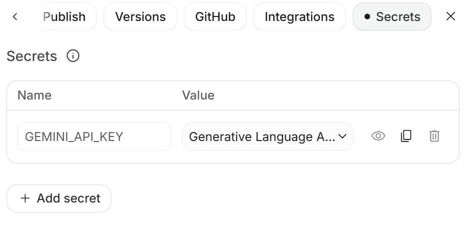

# 从空白创建 AI Studio App

本教程用于创建供 AIStudioToAPI 使用的 AI Studio App，并获取 `AI_STUDIO_APP_URL` 所需的应用链接。每个部署都需要配置自己创建的 App。

## 1. 打开空白 App

登录 Google 账号后，访问 [AI Studio 空白 App](https://aistudio.google.com/apps/bundled/blank)。

点击页面右上角的 **Remix**。


## 2. 创建自己的副本

在弹窗中填写 **App name**，按需修改 **Description**，然后点击右下角的 **Remix app**。


等待副本创建完成。顶部出现应用名称后，点击预览区上方的 **Code**，进入代码编辑器。


## 3. 复制四个文件

在 AI Studio App 根目录中，按下表复制仓库当前版本的完整文件内容：

| 仓库文件                                                           | App 中的文件   | 操作               |
| ------------------------------------------------------------------ | -------------- | ------------------ |
| [`scripts/client/build.js`](../../scripts/client/build.js)         | `index.ts`     | 替换全部内容       |
| [`scripts/client/index.html`](../../scripts/client/index.html)     | `index.html`   | 替换全部内容       |
| [`scripts/client/server.mjs`](../../scripts/client/server.mjs)     | `server.mjs`   | 新建并复制全部内容 |
| [`scripts/client/package.json`](../../scripts/client/package.json) | `package.json` | 替换全部内容       |

`server.mjs` 负责启动页面服务和 Gemini 请求转发，`package.json` 提供对应的启动命令和依赖。

保留空白模板中的其他文件，包括 `vite.config.ts`、`tsconfig.json`、`index.css`、`.gitignore`、`.env.local` 和 `README.md`。

## 4. 配置 metadata.json

打开 App 中已有的 `metadata.json`，将 `majorCapabilities` 的空数组改为：

```json
["MAJOR_CAPABILITY_SERVER_SIDE_GEMINI_API"]
```

保留自己的应用名称、描述和 `requestFramePermissions`。完整文件应类似下面的格式，最后一个字段后不要加逗号：

```json
{
  "name": "My AIStudioToAPI",
  "description": "My AI Studio app for AIStudioToAPI",
  "requestFramePermissions": [],
  "majorCapabilities": ["MAJOR_CAPABILITY_SERVER_SIDE_GEMINI_API"]
}
```

## 5. 设置 API Key

点击页面右上角的 **Settings（设置）**，然后点击 **Secrets（密钥）**。找到 `GEMINI_API_KEY`，根据需要在 **Value** 下拉框中选择或更换 Key。应用从服务端环境变量读取 Key，请将 Key 保存在 Secrets 中。



> **所有使用这个 App 的用户都共用 App 配置的 `GEMINI_API_KEY`，调用会计入该 Key 所属项目的额度。** 切换访问 App 的 Google 账号或多开本地 AIStudioToAPI 实例不会分离这份额度。详见 [AI Studio 官方说明（中文）](https://ai.google.dev/gemini-api/docs/aistudio-build-mode?hl=zh-cn#api-key-exposed)。

保存所有文件并重启应用，然后继续配置访问权限和应用链接。

## 6. 设置访问权限并复制链接

点击页面右上角的 **Share**，确保运行 AIStudioToAPI 的 Google 账号有权访问该 App。

需要让多个账号通过公开链接访问时：

1. 在 **General access** 中选择 **Public: Anyone with the link can view**。
2. 点击分享面板底部的 **Copy link**。


如果使用账号已经有访问权限，可以保留现有权限设置，直接复制应用链接。链接格式应类似：

```text
https://ai.studio/apps/xxxxxxxx-xxxx-xxxx-xxxx-xxxxxxxxxxxx
```

## 7. 配置 AIStudioToAPI 并验证

回到运行 AIStudioToAPI 的项目，将复制的完整链接填入环境变量：

```env
AI_STUDIO_APP_URL=https://ai.studio/apps/xxxxxxxx-xxxx-xxxx-xxxx-xxxxxxxxxxxx
```

- 使用 `npm start` 时，写入项目根目录的 `.env`。
- 使用 `npm run dev` 时，写入项目根目录的 `.env.development`。
- 使用 Docker 时，设置容器的同名环境变量。

保存后重启 AIStudioToAPI，确认启动日志中的 `AI Studio App URL` 显示你的应用地址。

最后，通过 API 客户端发送一次请求，确认能够收到并正常解析模型回复，创建流程即完成。
